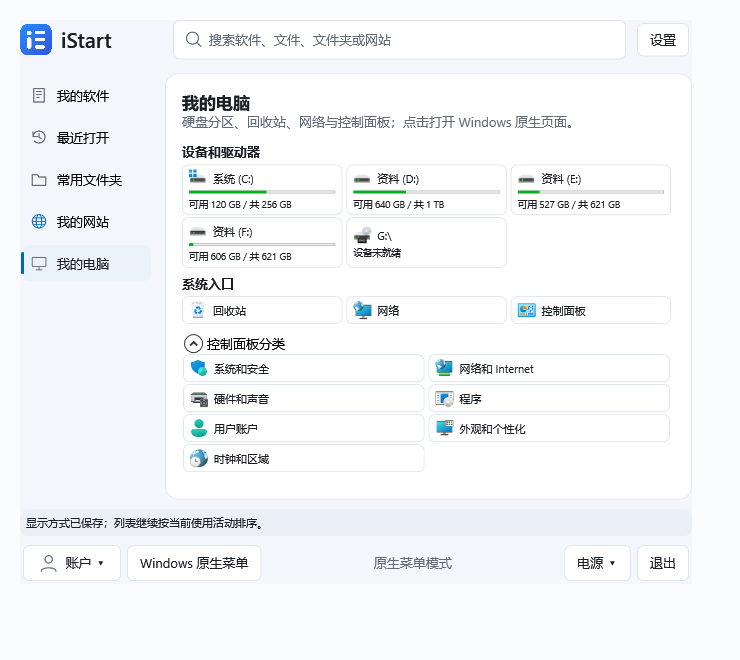

# iStart

把常用软件、最近文件、文件夹和网站集中到一个紧凑的 Windows 个人开始菜单，让桌面更清爽。

**当前发布：0.2.0-preview.18 预览版**

[下载 Windows x64 安装包](https://github.com/morrowfactory/istart/releases/download/v0.2.0-preview.18/iStart-Setup-0.2.0-preview.18.exe) · [版本与校验文件](https://github.com/morrowfactory/istart/releases/tag/v0.2.0-preview.18) · [所有版本](https://github.com/morrowfactory/istart/releases)

## 当前功能

开发版 preview.19（尚未发布）新增“截屏”：菜单顶部点击后隐藏 iStart，拖选当前显示器的范围；支持移动选区、拖动边角缩放，以及彩色箭头、圆圈、方框、画笔、文字和矩形马赛克。工具栏跟随选区，点击“完成”复制图片或保存 PNG；Esc 取消、Ctrl+Z 撤销、Ctrl+C 复制。文字按 Enter 完成，Shift+Enter 换行。截图不会自动保存或上传；不包含文字识别、翻译和滚动长截图。

本版新增“我的电脑”和应用内升级。公开安装包与校验信息见上方发布链接。

| 入口 | 显示内容 | 排序与限制 |
| --- | --- | --- |
| 我的软件 | 有本机活动依据或手动添加的软件 | 使用多的在前，最多 30 个；搜索也最多 30 个 |
| 最近打开 | iStart、Windows、WPS、LibreOffice 等留下记录的有效文件 | 最近优先、去重，最多 100 项；不显示文件夹和程序 |
| 常用文件夹 | 已添加目录及本机活动中的目录 | 默认常用优先，同页按钮切换最近打开；按窗口空位补充 |
| 我的网站 | Chrome 和 Edge 的有限本机浏览历史，按域名合并 | 默认常用优先，同页按钮切换最近网址清单，最多 30 个 |
| 我的电脑 | 硬盘分区、可用容量、回收站、网络、可展开的 7 个控制面板大类（不含轻松使用） | 点击系统项目打开 Windows 原生页面；支持当前页搜索 |

- Windows 11 Fluent / Google 两种风格，在设置中即时切换并保存。
- 桌面、任务栏、窗口、托盘、安装器和菜单使用统一 iStart 图标。
- 软件和文件夹可拖入添加；支持图标/列表显示、搜索和隐藏。
- 保留 Windows 原生菜单恢复、账户、电源和托盘入口。
- 已移除独立软件推荐区、未分类、新建分类和分类名称输入框；旧入口数据保留兼容。



界面示意使用测试磁盘容量；实际内容来自当前账户的本机系统与活动记录。详见[活动视图说明](docs/ACTIVITY_VIEWS.md)。

## 安装与使用

1. 下载并运行安装包，按中文向导选择位置与选项，查看实际安装进度。
2. 安装仅用于当前账户，无需管理员权限，也无需另装 .NET。新安装默认不创建桌面快捷方式、不启用开机启动、不接管开始入口；可按需勾选。
3. 从五个入口访问内容，直接输入搜索文字；拖入软件快捷方式和文件夹可添加入口。
4. 在“设置 → 外观风格”选择 Windows 或 Google。网站与文件夹页面的按钮可切换常用/最近，选择会保存。

设置底部显示当前版本；点击“检查更新 / 升级”打开升级页，查看版本说明、下载进度和校验结果，再点击安装进入升级向导。更新仅连接 `morrowfactory/istart` 的 GitHub Releases，预览版跟随更高预览版或正式版，正式版只跟随正式版；不会自动静默安装。下载失败或关闭升级窗口时当前程序继续可用。开发和验收运行不能启动覆盖安装。

安装包目前未签名。升级保留原有入口、记录和有效设置；旧分类数据保留，但不再显示分类编辑界面。隐藏入口不会卸载软件、移动原文件或删除浏览器历史。

## 原生菜单与退出

- 底部“Windows 原生菜单”：临时打开系统菜单。
- 托盘“切回 Windows 原生菜单”：停用自定义接入，恢复默认原生模式。
- 右上角“×”：收起到托盘；菜单或托盘的“退出”才结束程序并释放接入。
- 上次异常退出时，下次启动恢复原生模式；卸载默认保留个人配置。

账户与电源操作遵循系统能力和策略，注销、关机等需要确认；登录认证、Windows Hello 和安全桌面仍由 Windows 管理。

## 兼容性与已知限制

本版增加已知 Win10/11 版本的能力检测试用和设置内诊断导出；preview.17 及更旧版本仍只允许 26200 接入。

目标为 Windows 10/11 x64，目前仍是预览版，不能视为已完成双系统兼容验收。

| 系统 | 当前验证范围 |
| --- | --- |
| Windows 11 25H2 x64，26200.9457 | 开始按钮、单独 Win 键、Win+R 保留及基本恢复已实机检查；基本接入与恢复已实机验证；继续优先使用 UIAutomation 定位 |
| Windows 10 19041–19045；Windows 11 22000、22621、22631、26100 | 允许用户主动启用兼容试用，成功定位按钮后才安装钩子；尚无对应系统实机验收 |
| 其他版本、定位失败或异常恢复 | 保持原生入口；不猜测开始按钮坐标 |

设置中的“导出开始菜单兼容诊断”保存版本策略、显示器数量、按钮数量/边界与识别方式，不包含软件列表、文件路径或网址，不上传数据。详细测试范围见[Windows 兼容说明](docs/WINDOWS_COMPATIBILITY.md)。

Explorer 重启、多屏缩放、自动隐藏任务栏、长期稳定性，以及交互式安装取消/失败回退仍需进一步验证。运行时支持与应用实测需分别判断，参见 [.NET 官方系统矩阵](https://github.com/dotnet/core/blob/main/release-notes/10.0/supported-os.md)。

## 本地数据与隐私

- 配置位于 `%LOCALAPPDATA%\iStart\library.json`，保留一份 `.bak`。卸载不主动删除个人入口和记录。
- 活动整理在本机进行，不上传软件列表、文件路径或浏览历史，不扫描全盘。检查更新与下载是用户主动触发的 GitHub 网络请求。
- 软件排序参考 Windows 累计应用切换与 iStart 打开记录；目录排序参考打开次数及近期文件活动，均不是完整系统频率或精确月统计。
- 网站只读取 Chrome/Edge 保留的有限历史，不读取 Cookie、密码、网页内容或无痕会话；同域名合并后打开网站根地址。
- 设置可关闭外部文件/文件夹活动或浏览器历史读取。“清除 iStart 记录”不会清除外部历史。
- 浏览器历史快照仅在本机临时使用，正常读取后清理；不可读、部分失败或超时会提示。
- 升级下载缓存在 `%LOCALAPPDATA%\iStart\Updates`；取消或失败清理本次下载。成功后清理超过 7 天的旧更新缓存，至少保留最近两次下载，不清理个人数据。
- `runtime.log` 记录运行与恢复诊断，不记录按键、网址或文件内容；超过 64 KiB 轮转，只保留一份旧日志。

## 构建与验证

需要 Windows、.NET 10 SDK；构建安装包另需 Inno Setup 7.1.0。

```powershell
dotnet run --project src/IStart.App/IStart.App.csproj
./scripts/Test-Prototype.ps1
./scripts/Publish-Preview.ps1
./scripts/Build-Installer.ps1 -Compiler 'C:\path\ISCC.exe' -SkipPublish
./scripts/Build-Installer.ps1 -Compiler 'C:\path\ISCC.exe' -SkipPublish -TestInstall
./scripts/Test-Installer.ps1 -Package "$PWD\artifacts\setup\iStart-QA-Setup-0.2.0-preview.18.exe" -Output "$PWD\artifacts\install-test"
```

安装包及 SHA256 输出到 `artifacts/setup/`。QA 安装器使用隔离身份；验证输出目录必须位于 `artifacts/` 且尚不存在。

`--probe-system <目录>` 只读检查驱动器、控制面板项目数量和 GitHub 可升级版本，不启动系统项目或安装器。

`--ui-test <目录>` 使用独立配置验收界面，不修改真实开机启动；`--probe-activity <目录>` 只输出活动来源数量。`--input-test <目录>` 会操作原生菜单/运行窗口并结束它自己启动的测试子进程，仅在空闲交互桌面手动执行，不纳入 CI。

GitHub CI 验证构建、核心行为、布局及隔离安装/覆盖/卸载，临时产物保留 7 天。公开安装包通过[发布流程](docs/GITHUB_RELEASE.md)使用最新 main 的已验证 CI 产物，核对来源 SHA 和哈希后发布；不包含个人配置或历史。

Inno Setup 7 有商业使用许可要求，商业发行前需取得适用授权，参见 [Inno 许可](https://jrsoftware.org/isorder.php)。项目未复制 Open-Shell 代码。

## 项目文档

- [架构](ARCHITECTURE.md)：模块、存储、活动来源和恢复边界。
- [愿景](VISION.md)：产品方向、体验与隐私原则。
- [执行计划](EXECUTION_PLAN.md)：阶段进展和待完成验收。
- [活动视图](docs/ACTIVITY_VIEWS.md)：软件、目录、网站的排序、字段与读取限制。
- [统一图标](docs/BRAND_ICON.md)：Figma 来源和资源维护。
- [窗口与焦点验证](docs/FOREGROUND_VALIDATION.md)：置前、定位与直接输入。
- [当前系统实机验收](docs/CURRENT_SYSTEM_VALIDATION.md)：历史实测范围与未执行项。
- [我的电脑与升级验证](docs/COMPUTER_UPDATE_VALIDATION.md)：系统项目、更新来源与已测范围。
- [GitHub 发布](docs/GITHUB_RELEASE.md)：版本来源、完整性校验与回退。
