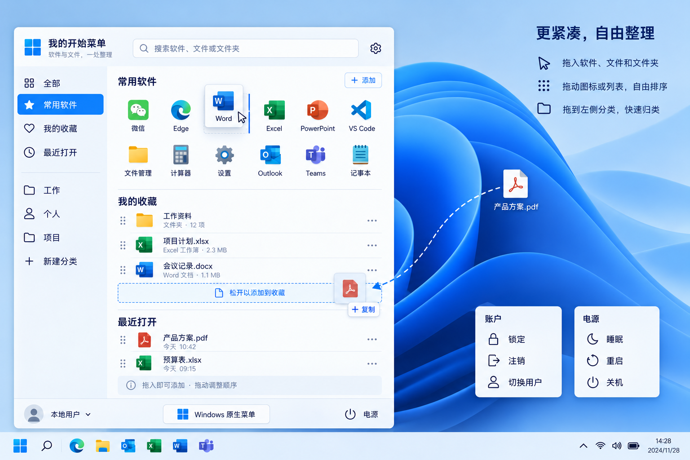

# iStart

面向 Windows 10 和 Windows 11 的个人开始菜单：把常用软件、文件和文件夹集中整理，减少桌面混乱。

## 当前状态

项目处于需求与静态原型阶段。当前仓库包含产品说明、目标架构和视觉原型，尚无可运行程序、安装包或兼容性测试结果。下述功能均为开发目标，不代表已经实现。

## 已确认的产品需求

- 点击任务栏开始按钮或按 Win 键，打开自定义菜单。
- 使用紧凑双栏布局：左侧分类，右侧软件网格及文件列表，顶部搜索。
- 将软件快捷方式、文件和文件夹拖入菜单，添加访问入口；不移动或复制原文件。
- 拖动图标、列表条目及分类，自由排序，并保存布局；拖到分类上完成归类。
- 提供手动收藏、常用软件、最近打开和自定义分类。
- 随时临时打开原生菜单，或将默认菜单切回 Windows 原生菜单。
- 保留账户操作及关机、重启、睡眠；休眠按系统能力与配置显示。
- 保留 Windows 登录、锁屏、密码、PIN、指纹、人脸识别和 Ctrl+Alt+Delete 界面。
- 提供托盘恢复入口，退出、卸载及异常恢复时能够恢复原生入口。

“最近打开”以 Windows 可提供的记录和 iStart 自身启动记录为范围，不能保证覆盖所有软件内部打开的文件。固定收藏的顺序由用户决定；使用频率仅影响独立的常用推荐区域。

## 视觉原型

图中拖拽、账户与电源面板是操作示意，不是运行截图。拖入操作在实际产品中表示添加引用，原型中的“复制”提示不代表复制文件内容。右侧账户和电源面板用于分别说明选项，不要求同时展开。

## 文档导航

- [架构说明](ARCHITECTURE.md)：模块边界、数据模型、系统接入与恢复设计。
- [产品愿景](VISION.md)：产品原则、范围、阶段与验收目标。

## 开发起点

1. 先制作可运行的紧凑菜单，验证拖入、排序、分类及本地保存。
2. 单独验证 Windows 10/11 的开始按钮和 Win 键接入、临时打开原生菜单及恢复行为。
3. 接入软件发现、最近记录和系统账户、电源操作。
4. 完成兼容性矩阵、安装、升级、退出和卸载验证后，再发布安装包。

目前未确定最终技术栈，暂无构建或运行命令。Open-Shell 是系统接入的候选参考，不是已引入依赖；采用其代码前须审查许可证、维护状态和兼容性。

## 协作约定

PR、Issue、评审及验收说明使用中文；代码标识和错误原文保留原文。实现变更同步检查本文件、ARCHITECTURE.md 和 VISION.md。不得把计划功能写成已验证能力，也不得提交个人文件路径、最近记录、凭据或其他敏感数据。
