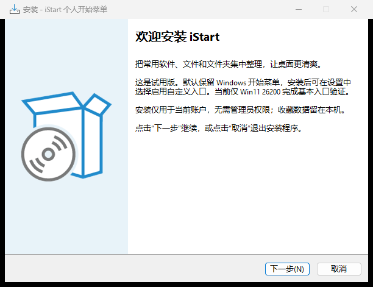
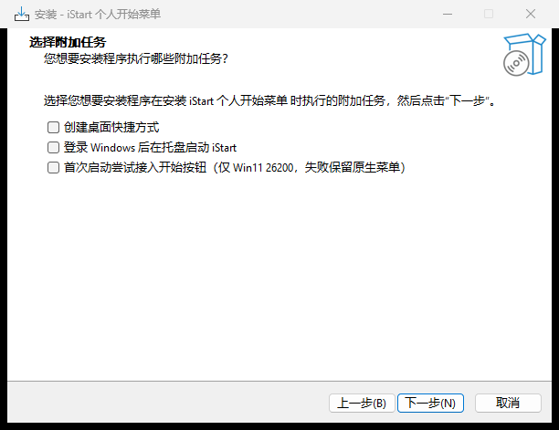
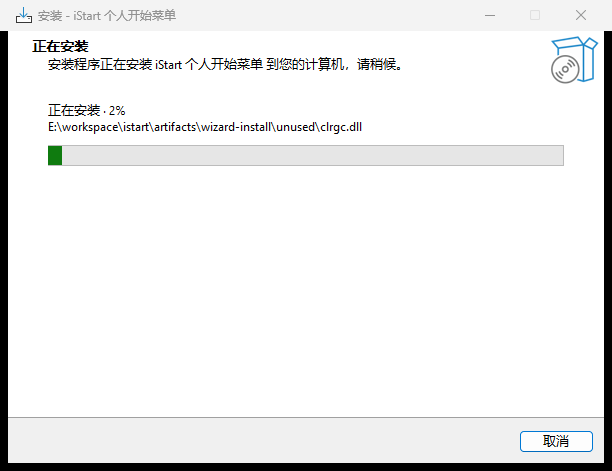
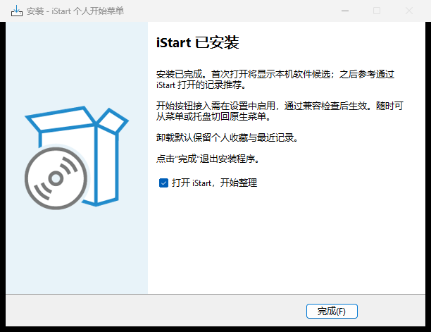

# P0 技术验证记录

日期：2026-10-13。当前为 0.2.0-preview.2，已完成可运行菜单、Win11 基本接入及中文安装包。P0–P4 尚未通过全部验收，不能作为 Win10/11 正式兼容结论。

## 已通过

| 项目 | 实际证据 |
| --- | --- |
| 当前系统 | Windows 11 25H2 x64，26200.9457；旧 ProductName 显示 Windows 10，按真实内部版本归类 |
| 编译 | .NET SDK 10.0.401，Release 0 警告、0 错误 |
| 核心行为 | 添加、去重、分类排序、重载、移除不删源文件、配置恢复、未知版本保护、保存失败内存回退 |
| 新数据行为 | schema 1→2 保留收藏；最近记录次数、关闭、100 项上限与清除；删除分类保留收藏 |
| 软件推荐 | 合成中文快捷方式过滤与目标去重，推荐开关和排除保存；自身启动次数参与排序 |
| 布局 | WPF 列表与图标视图渲染，图标由 Windows Shell 获取 |
| Win11 接入 | 开始按钮点击和单独 Win 各触发一次自定义回调；未同时打开原生菜单 |
| 原生与快捷键 | Win+R 不触发自定义回调；Ctrl+Esc 临时原生交接不递归；禁用接入后 Win 恢复原生 |
| 异常恢复 | 独立测试子进程启用钩子后被强制退出，Win 再次打开原生菜单；只结束该测试子进程 |
| 安装打包 | Inno Setup 7.1.0 中文安装包、自包含 win-x64、SHA256 |
| 安装页面 | 实际安装窗口截图：欢迎、位置、选项、准备、2% 文件安装进度和完成页；基础中文显示已检查，缩放仍待验证 |
| 安装生命周期 | 独立 QA AppId、中文空格路径：静默首次安装、覆盖安装、卸载通过；日志 Removed all? Yes，无需重启 |

核心验证脚本 `scripts/Test-Prototype.ps1`；开始入口专项结果位于本次本地产物 `artifacts/input-final/input-result.txt`，该检查安装回调而非打开真实菜单窗口，不能等同所有交互已验收。实测原生基线前台进程为 SearchHost，按当前基线比较，不硬编码所有系统的菜单进程名。

安装检查 `scripts/Test-Installer.ps1` 使用 QA 安装器，不启动真实菜单、不写开机启动、不关闭正式实例；结果在 `artifacts/install-final/result.txt`。安装目录已由卸载清理，保留小型验收日志。没有生产服务器、生产备份或业务数据变更。

## 尚未通过或执行

- Win10 及其他 Win11 版本无可用测试环境；仅 26200 白名单允许试用接入。未知版本保持原生入口。
- Explorer 重启、任务栏左右对齐、自动隐藏、多显示器、缩放、锁屏返回和睡眠恢复。
- 真实鼠标完整拖放、网格排序、右键管理、撤销与键盘/高对比辅助功能仍需人工验收。模型/事件检查不替代完整交互测试。
- 账户电源已实现能力/策略判断和固定参数，仅验证不会使用 /f；未执行注销、重启、睡眠等会中断工作会话的操作。
- 历史常用来源无可靠证据，当前只使用已安装候选和 iStart 自身记录，不读取全系统历史。
- 安装交互取消、权限拒绝、空间不足、运行中文件占用、升级中断及完整失败回退尚待隔离环境测试。
- 代码签名、自动更新、正式发行和完整兼容认证尚未完成。

## 接入与回退

使用进程所属低级键盘/鼠标钩子与 UIAutomation 开始按钮定位；无 Explorer 注入、系统文件修改、服务或驱动。开始按钮边界缓存需新鲜且与当前任务栏一致。后台扫描失败时停用接入，扫描超时不重复创建未完成扫描。

默认原生；启用须明确选择并通过版本检测。临时原生按钮不改变偏好，托盘可切回默认原生；关闭程序释放钩子。session.active 遗留时，下次运行恢复原生模式。低级钩子可能因超时被系统移除，目前没有可靠失效监测，仍属于试用边界。[微软说明](https://learn.microsoft.com/en-us/windows/win32/winmsg/lowlevelkeyboardproc)

收藏 JSON 原子替换并保留一份上一版本；升级 schema 后旧预览不兼容，不应混用。卸载保留用户配置与源文件。安装器复用 Inno 事务与取消机制，不把尚未演练的异常升级场景描述为已通过回退。

Open-Shell 根许可证为 MIT，当前未复制或链接代码。[许可证](https://github.com/Open-Shell/Open-Shell-Menu/blob/master/LICENSE)

## 验证包与 CI

安装包 `iStart-Setup-0.2.0-preview.2.exe` 与 `.sha256` 输出在 `artifacts/setup/`，ZIP 继续提供完整目录独立运行。用户选择自定义入口后，兼容检查失败则保留原生入口。开机启动为当前账户可选项，默认关闭。

Windows CI 验证构建、核心行为、布局、自包含打包及独立 QA 安装/覆盖/卸载，产物保留 7 天；不在无人值守 runner 执行桌面钩子测试，不自动创建 Release。当前开发通过中文 PR，尚未合并或公开正式发布。

## 安装页面取证

## 当前系统后续验收

已补充真实内部拖动、搜索、添加、重命名、重新定位与完整菜单进程恢复检查；范围和剩余项见 [当前系统实机验收](CURRENT_SYSTEM_VALIDATION.md)，不能把未执行的按键/跨窗口/会话操作标成通过。
